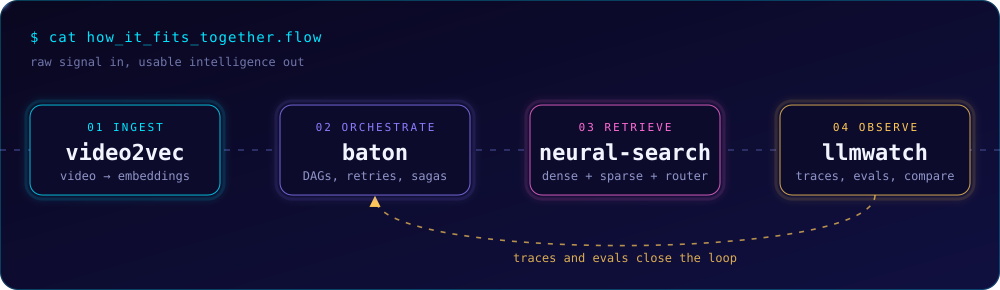

<div align="center">



<br/>

<a href="https://ulucan.dev"></a>
<a href="mailto:omer@ulucan.dev"></a>
<a href="https://x.com/senorulucan"></a>


</div>

<br/>

## `> whoami`

```python
class Omer:
    school   = "UT Dallas, Computer Science"
    based_in = ["Dallas, TX", "Austin, TX"]
    focus    = ["LLM infrastructure", "agentic systems", "research to production"]
    building = "Iusis (iusis.app), AI for small immigration law firms"
    looking  = "AI/ML, SWE and other engineering roles"
```

<br/>

## `> how my projects fit together`

<div align="center">

</div>

<br/>

## `> featured projects`

<table>
  <tr>
    <td width="50%" valign="top">
      <h3>🎞️ <a href="https://github.com/omer-ulucan/video2vec">video2vec</a></h3>
      <p>C++20 pipeline that turns video into LLM-ready transcripts, on-screen text and visual embeddings on a millisecond timeline.</p>
      
    </td>
    <td width="50%" valign="top">
      <h3>🎼 <a href="https://github.com/omer-ulucan/baton">baton</a></h3>
      <p>Distributed task orchestrator: YAML DAG workflows, retries, saga compensation, leader election, PostgreSQL state.</p>
      
      
    </td>
  </tr>
  <tr>
    <td width="50%" valign="top">
      <h3>🔭 <a href="https://github.com/omer-ulucan/llmwatch">llmwatch</a></h3>
      <p>Self-hosted LLM observability and evals: log calls, trace agent runs, compare models.</p>
      
    </td>
    <td width="50%" valign="top">
      <h3>🧭 <a href="https://github.com/omer-ulucan/neural-search">neural-search</a></h3>
      <p>Local hybrid search for technical docs: dense and sparse vectors in Qdrant with a LangGraph router.</p>
      
      
    </td>
  </tr>
  <tr>
    <td colspan="2" valign="top">
      <h3>🗑️ <a href="https://trashmapatx.com">TrashMap ATX</a> <sub>Riverhack 2025 winner</sub></h3>
      <p>Users photograph illegal dumping, an EfficientNet-V2 model classifies it (97% accuracy), and reports show up on a map next to City of Austin data. PyTorch, FastAPI, Docker.</p>
    </td>
  </tr>
</table>

<br/>

## `> stack`

<div align="center">


</div>

<br/>

## `> arcade mode: my contributions, eaten by pac-man`

<div align="center">

<picture>
  <source media="(prefers-color-scheme: dark)" srcset="https://raw.githubusercontent.com/omer-ulucan/omer-ulucan/output/pacman-contribution-graph-dark.svg" />
  <source media="(prefers-color-scheme: light)" srcset="https://raw.githubusercontent.com/omer-ulucan/omer-ulucan/output/pacman-contribution-graph.svg" />
  
</picture>

<details>
<summary><b>insert coin for breakout</b></summary>
<br/>

<picture>
  <source media="(prefers-color-scheme: dark)" srcset="https://raw.githubusercontent.com/omer-ulucan/omer-ulucan/output/breakout-contribution-graph-dark.svg" />
  <source media="(prefers-color-scheme: light)" srcset="https://raw.githubusercontent.com/omer-ulucan/omer-ulucan/output/breakout-contribution-graph.svg" />
  
</picture>

</details>

</div>

<br/>

## `> stats`

<div align="center">


</div>